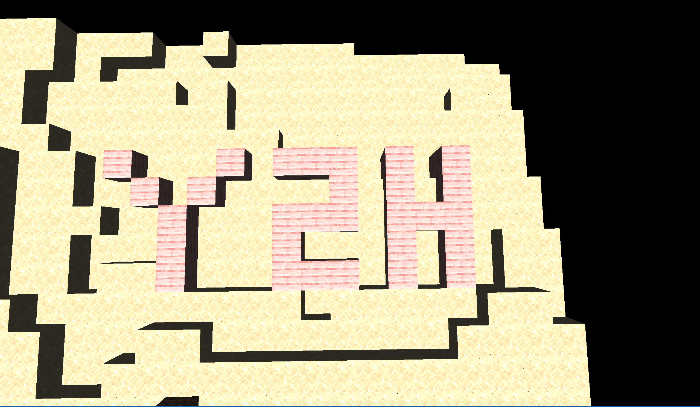
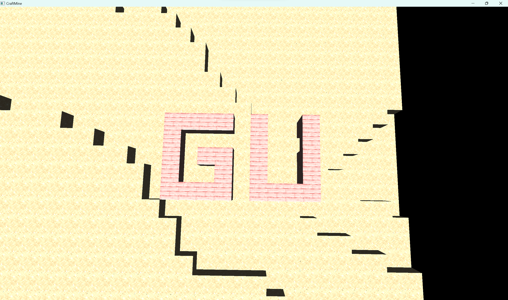

## ~~Reminder: After a period of rushed development, this repository has successfully turned into a spaghetti code mountain. It is **not recommended** to use or reference this codebase for any reason—unless you want to learn how to write terrible code.~~

Maintenance of the spaghetti mountain will continue until **2025.8.30**

<a href="./README.md">中文</a>

## Expected Result

## TodoList

* [x] Ticking system

    * [x] Frame rate calculation
* [x] Game window

    * [x] Lighting system
    * [x] Terrain generation

        * [x] Perlin noise calculation
        * [x] Skybox
        * [x] Block PNG mask
        * [x] Block face rendering
    * [x] Crosshair
    * [x] Mouse pointer dynamics
    * [x] Keyboard mapping
* [ ] Blocks

    * [x] Grass block
    * [x] Stone
    * [x] Dirt
    * [x] Log
    * [x] Sand
    * [x] Planks

        * [ ] ~~Crafting table and recipe system (TBD)~~
    * [x] Block breaking
    * [x] Block rendering
* [ ] ~~Entities~~

    * [ ] ~~Player~~

        * [x] Actions

            * [x] Movement
            * [ ] ~~Jumping~~
            * [ ] ~~Swimming~~
            * [ ] ~~Jumping underwater~~
            * [x] Flying mode (TBD)
            * [x] Breaking blocks

                * [x] Calculate block pointed by the cursor
                * [ ] ~~Play breaking animation~~
            * [x] Placing blocks

                * [x] Calculate block pointed by the cursor
        * [x] ~~Inventory~~
    * [ ] ~~Monsters (TBD)~~
    * [ ] ~~Dropped items (TBD)~~

## How to Run

1. Clone the repository to your local machine
2. Make sure you have Maven installed (comes with IntelliJ IDEA)
3. Update Maven dependencies to ensure no errors in `pom.xml`
4. Run the project

If you get an error about the root not being marked as a source directory, set `src` as the source root.

## Known ~~Bugs~~ Features

* Occasionally, placing blocks too quickly may trap the player, and sometimes breaking those blocks won't remove them from rendering
* No boundary checks due to time constraints — placing blocks outside bounds will cause exceptions and crash the program
* Due to floating-point precision, holding left mouse to break blocks may take longer than expected
* Pressing `ESC` to release the mouse forcibly resets the camera angle and stops movement input
* No gimbal lock prevention in camera rotation, so the view might flip under certain conditions — swinging the mouse rapidly can restore it
* Sometimes the view becomes unresponsive due to the mouse moving too fast and leaving the window — press `ESC` twice to reset
* Player collision is inexplicably larger than configured; at least a 2×2×2 space is required for movement
* LWJGL depth testing conflicts with skybox rendering — ~~skybox has been removed~~
* Why is there so much sand? Because there's no time to implement water

## How to Play

1. Use `WASD` to move
2. Press `Space` to fly upward, `Shift` to fly downward
3. Hold **left mouse** to break blocks, click **right mouse** to place blocks
4. Press `Esc` to release the mouse
5. Modify game parameters in `src/com/craftmine/game/GameResources.java`
6. Use number keys 1–8 to switch block types

You **might** also change the map size in `src/com/craftmine/game/GameResources.java` to stress-test your machine (just kidding, not recommended though)

## Planned Third-Party Libraries

[LWJGL](https://www.lwjgl.org/): Graphical interface and related libraries

* [openAL](https://www.openal.org/): Cross-platform 3D audio API suitable for games and other audio apps
* [openGL](https://www.khronos.org/opengl/): The most widely adopted 2D/3D graphics API across computing platforms
* [GLFW](https://www.glfw.org/): Window creation, input handling, multi-monitor, clipboard, drag-n-drop, etc.
* [Assimp](https://www.assimp.org/): Portable open-source library to import various 3D model formats
* [STB](https://github.com/nothings/stb)
* [ImGUI](https://github.com/ocornut/imgui): GUI/debugging tools

[JOML](https://joml-ci.github.io/JOML/): A math library for OpenGL rendering in Java

## References

[Chinese Minecraft Developer Guide](https://github.com/mouse0w0/MinecraftDeveloperGuide?tab=readme-ov-file)
[Generating Terrain with Perlin Noise Using Only 7 Command Blocks?! (Bilibili)](https://www.bilibili.com/video/BV1vfKJedEdA/)
~~[How to Use Perlin Noise in Your Games](http://devmag.org.za/2009/04/25/perlin-noise/)~~ — In English, didn’t finish reading
~~[《3D Game Development with LWJGL 3》Chinese Translation](https://mouse0w0.github.io/lwjglbook-CN-Translation/02-the-game-loop/)~~ — outdated translation
[3D Game Development with LWJGL 3](https://ahbejarano.gitbook.io/lwjglgamedev) and its [Chinese translation](https://yin2hao.github.io/lwjglbook-CN-Translation/)
[GLFW Official Docs](https://www.glfw.org/docs/latest/)
[OpenGL Official Docs](https://www.khronos.org/opengl/wiki/Main_Page)

## Referenced Projects

Some features referenced from [MineCraftMini](https://github.com/wyndwarrior/MineCraftMini)
Overall design inspired by [3D Game Development with LWJGL 3](https://github.com/lwjglgamedev/lwjglbook)